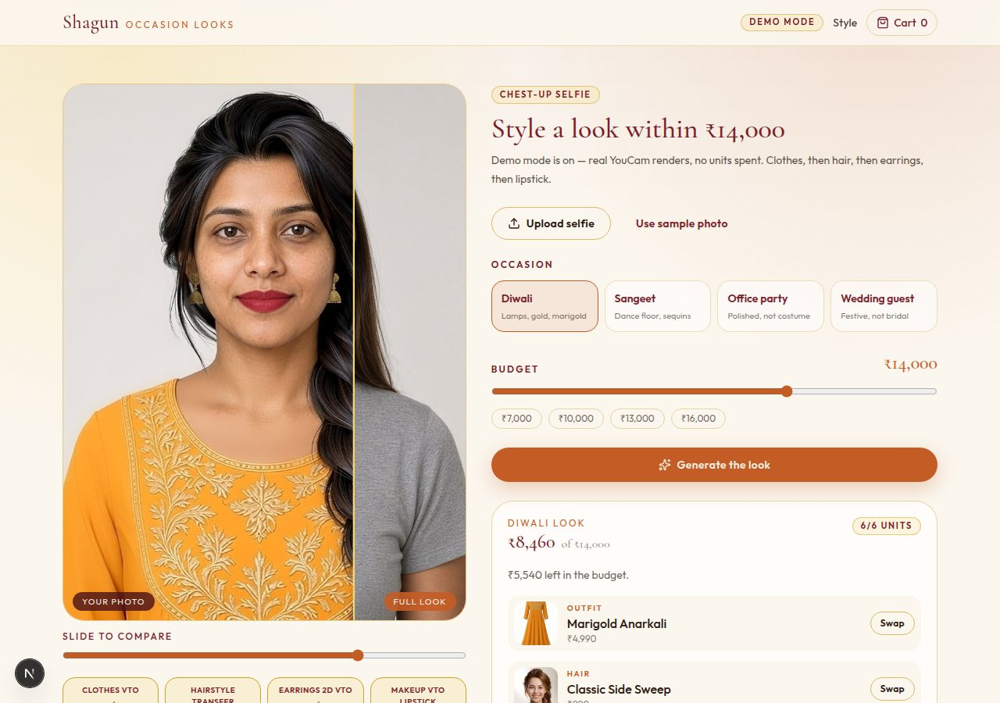

# Shagun

Indian occasion-styling store for the Devpost **YouCam API Skin AI & eCommerce VTO Hackathon**.

Upload a chest-up selfie, pick an occasion (Diwali, sangeet, office party, wedding guest) and a rupee budget. Shagun picks an outfit, hairstyle, earrings and lip shade, then **chains four YouCam APIs** onto the same face. Swap one SKU and only the downstream steps re-render. One tap adds all four items to a cart that stays within budget.

Public GitHub: [RockingThor/shagun](https://github.com/RockingThor/shagun)



**MIT License.** See [LICENSE](LICENSE). Hackathon deadline: **Mon 2 Nov 2026, 10:15 PM IST**.

## YouCam APIs and chain order

Hair must run **before** earrings. Hair-transfer redraws the head and erases jewellery if the order is reversed. Loose hair over the ears can fail earrings with `earlobe alignment not confident` (not charged); live mode skips that step and suggests an updo.

| Step | YouCam API | Path | Units |
|---|---|---|---|
| 1. Clothes VTO | `cloth-v4` | `/s2s/v2.0/task/cloth-v4` | 2 |
| 2. Hair transfer | `hair-transfer` v2.1 | `/s2s/v2.1/task/hair-transfer` | 2 |
| 3. Earrings 2D VTO | `2d-vto/earring` | `/s2s/v2.0/task/2d-vto/earring` | 1 (skipped if lobes are covered) |
| 4. Makeup VTO lipstick | `makeup-vto` | `/s2s/v2.0/task/makeup-vto` | 1 |
| **Full look** | chained | | **6** |

Each successful result is re-encoded to JPEG (max side 1024) and re-uploaded so the next task always gets a JPG.

A lipstick swap costs 1 unit; an earring swap costs 2; a hair swap costs 4.

India-region host: `https://yce-api-01.makeupar.com`. Auth is `Authorization: Bearer <YOUCAM_API_KEY>` on the **server only**. The key is never sent to the browser.

## Demo mode (default, no key)

Demo mode is on whenever `YOUCAM_API_KEY` is empty, or when `DEMO_MODE=true`. It uses real captured YouCam renders and spends **zero units**.

```bash
npm install
cp .env.example .env.local   # leave YOUCAM_API_KEY empty
npm test
npm run dev
```

Open [http://127.0.0.1:43127](http://127.0.0.1:43127). Use **Use sample photo**, pick an occasion, generate the look.

| Occasion | Outfit | Hair (`template_id`) | Earrings | Lips |
|---|---|---|---|---|
| Diwali | Marigold Anarkali | side-sweep → `female_boho_side_braid` | Temple Jhumkas | Sindoor Rose `#B4233A` matte |
| Sangeet | Navy Sequin Co-ord | Gajra Bun → `female_messy_bun` | Kundan Chandbali | Festive Coral `#E05A4F` gloss |
| Office party | Ivory Cape Kurta | sleek-part → `female_sleek_middle_part` | Gold Hoops | Marigold Nude `#C4785A` matte |
| Wedding guest | Banarasi Wine Lehenga | bridal-bun → `female_casual_updo` | Pearl Drops | Berry Wine `#6B1D32` gloss |

Sample selfie: `public/demo/selfie.jpg` (768×1024). Step frames: `public/demo/looks/{occasion}-{clothes,hair,earrings,lipstick}.jpg`.

## Live mode (YouCam key on the server)

1. Copy `.env.example` → `.env.local`.
2. Put the YouCam key in `YOUCAM_API_KEY`. **Never commit `.env`, `.env.local`, or a real key.** `.gitignore` already ignores those files; only the empty template `.env.example` is tracked.
3. Set `DEMO_MODE=false`.
4. `npm run dev` — same URL. The server uploads JPEGs, starts the four tasks in order, and polls until each step completes.

`.env.example` documents every variable (`YOUCAM_API_BASE`, daily IP cap, feature paths, hair template overrides). Failed tasks are not charged. Earring PNG outputs are converted to JPEG before the next upload.

Live payloads:

- Clothes: `{ src_file_id, ref_file_id, garment_category: "upper_body" }`
- Hair: `{ src_file_id, template_id }` (input JPG, long side ≤ 1024)
- Earrings: `{ src_file_id, ref_file_ids, source_info, object_infos }` — `source_info` and `object_infos[].name` are required or YouCam returns 400
- Lipstick: `{ src_file_id, version: "1.0", effects: [{ category: "lip_color", … palettes }] }` with gloss 60 / transparency 30 on gloss shades

## License

[MIT](LICENSE) © 2026 Shagun.
